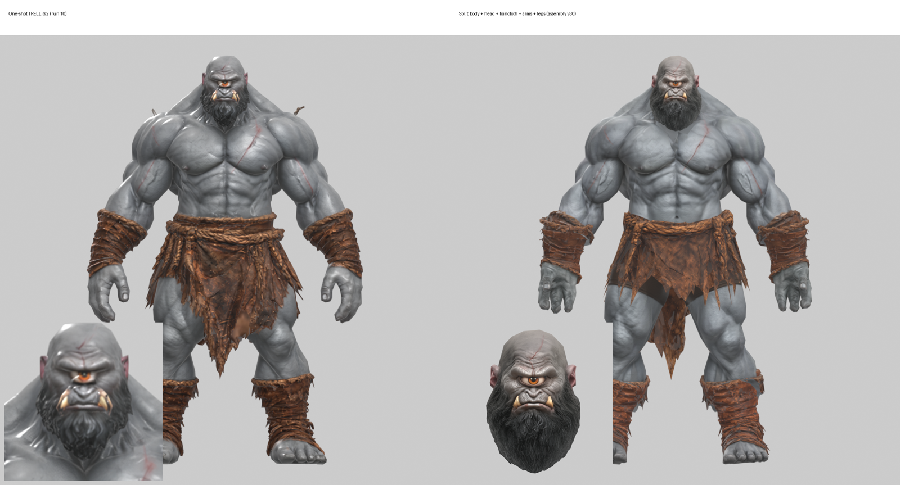
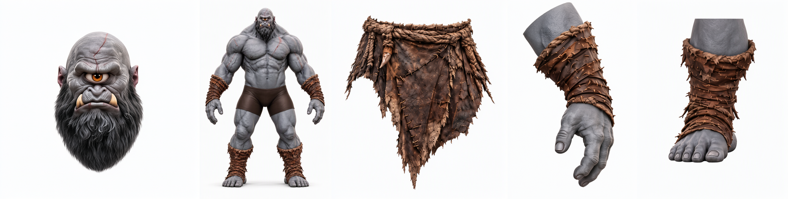
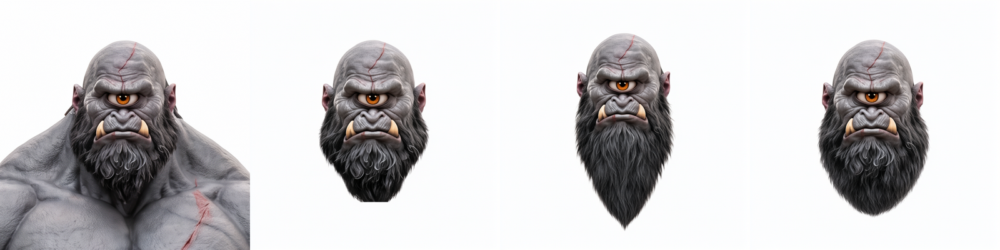
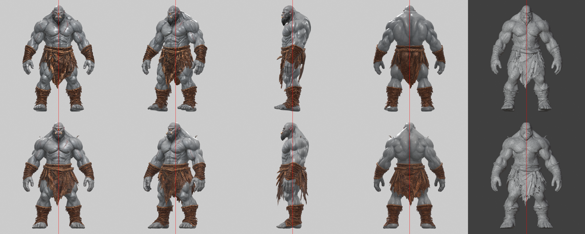
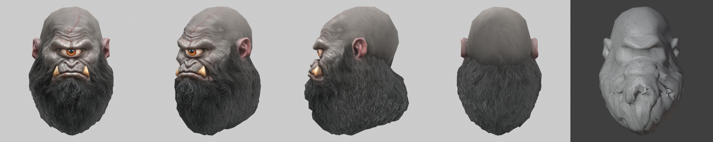
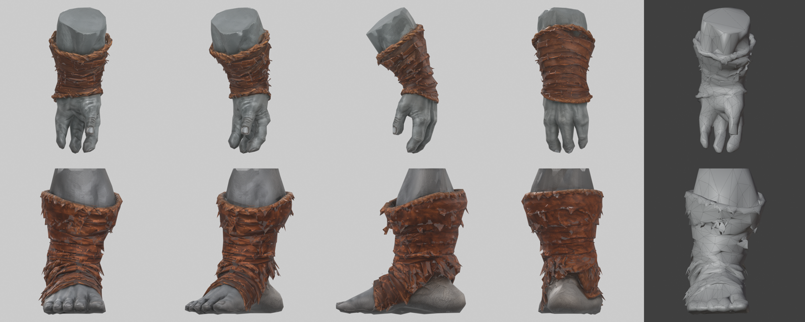
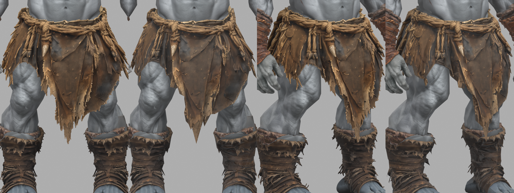

# PixelArtistry Split Character – sharper low-poly characters by generating them in parts

Free & local ComfyUI workflows: split **one character image** into parts with **Qwen Image 2.1**, turn each part into a textured low-poly mesh with **TRELLIS.2 + UltraTex**, and assemble them in Blender. A part that fills the whole image gets the full resolution of the 3D model and the texture – the face especially comes out much sharper than in a one-shot run.



```
character image ──► crop a part ──► Qwen Image 2.1 edit ──► isolated part (front view, white background)
                                                                        │
     Blender: assemble ◄── low-poly GLB ◄── TRELLIS.2 ► WTiVo ► LODTailor ► Bake Forger ► UltraTex
```

## The workflows

| Workflow | Does | Output |
|---|---|---|
| **PixelArtistry_07_Qwen21_Split_Character_Part** | Qwen Image 2.1 edit: isolates one part from a crop of your character, same camera and size | `output/split_parts/part_*.png` |
| **PixelArtistry_08_Part_to_LowPoly_TRELLIS2_UltraTex** | One part image to a textured low-poly GLB with TRELLIS.2, set up for parts (resolution 1024, voxel 0.005) | `output/3d/PixelArtistry_part_final_*.glb` |

Workflow 08 is [workflow 05 from PixelArtistry Animated Characters](https://github.com/pixelartistry/PixelArtistry-Animated-Characters) with the part settings below; it uses the same nodes and models.



## Requirements

- Windows, NVIDIA GPU (tested on an RTX 5080, 16 GB VRAM), ComfyUI 0.39.2 with Python 3.12 + PyTorch 2.8 + CUDA 12
- **For workflow 08:** install [PixelArtistry Animated Characters](https://github.com/pixelartistry/PixelArtistry-Animated-Characters) first (one-click installer: MostAadTech's 3D nodes, UltraTex, TRELLIS.2 models, Blender path)
- **For workflow 07:** Qwen Image 2.1 runs on ComfyUI's core nodes (0.37 or newer); only the models are needed:

| File | Folder | Source |
|---|---|---|
| `qwen_image_2.1_int8_convrot.safetensors` | `diffusion_models` | [Comfy-Org/Qwen-Image-2.1](https://huggingface.co/Comfy-Org/Qwen-Image-2.1/resolve/main/diffusion_models/qwen_image_2.1_int8_convrot.safetensors) |
| `qwen3vl_8b_int8_convrot.safetensors` | `text_encoders` | [Comfy-Org/Qwen-Image-2.1](https://huggingface.co/Comfy-Org/Qwen-Image-2.1/resolve/main/text_encoders/qwen3vl_8b_int8_convrot.safetensors) |
| `qwen_image_2.1_vae_bf16.safetensors` | `vae` | [Comfy-Org/Qwen-Image-2.1](https://huggingface.co/Comfy-Org/Qwen-Image-2.1/resolve/main/vae/qwen_image_2.1_vae_bf16.safetensors) |

- [Blender](https://www.blender.org) for the assembly (tested: 5.2.2)

## Install

1. **Code → Download ZIP** and unzip.
2. Copy both JSONs from `workflows` into `ComfyUI\user\default\workflows\PixelArtistry`.
3. Copy the images from `examples` into `ComfyUI\input` to try the example.
4. In workflow 08, set the **Blender path** node once (forward slashes, e.g. `D:/Blender/blender.exe`) – the Animated Characters installer has the path if you need it.

## How to use

### 1. Split the character (workflow 07)

1. Start from a full character image: straight front view, plain background, arms away from the body.
2. **Crop one part** generously and load it in **Load Image** (example: `example_head_crop.png`). For the body, load the whole image and set the encoder's resolution to **1536**.
3. Paste the matching prompt from [`prompts/`](prompts) into **Text Encode Qwen Image 2.1** and adjust it to your character.
4. **Run** (about 1 minute; 3–4 minutes the first time while the models load). Repeat for each part.

**The rule that makes the parts fit:** each part brings what hides its seam.

| Part | Includes | Seam hidden by |
|---|---|---|
| Body | everything except the loose items, with a low-detail head; loose cloth replaced by tight shorts | – |
| Head | the **whole beard** and the neck | beard over the throat |
| Loincloth | rope belt, flaps, pendant – no body | sits on top |
| Arm | forearm, **bracer** and hand | inside the bracer |
| Leg | shin, **wrap** and foot | inside the wrap |

Prompt pattern: *what to keep exactly* + *what to remove* + *strict front view, same camera, plain white background*. Name the length of things (a beard "exactly as long as in this image") – Qwen likes to make them longer.



### 2. Each part to 3D (workflow 08)

1. Load a part image in **Load Image**. Leave **Boolean (Switch to Trellis2)** on `true`.
2. Set the part's values (see Settings), then **Run** (about 10–13 minutes per part on an RTX 5080).

**Why TRELLIS.2 and not Pixal3D:** Pixal3D rebuilds the image in the camera space it estimates from the picture, so the perspective ends up in the shape (small head, long legs). Every part image gets its own camera, so Pixal3D parts don't fit together. TRELLIS.2 builds every part upright in the same space.







### 3. Assemble in Blender

Import the GLBs. All parts come from the same front camera, so line them up against the source image in front orthographic view:

- **Head:** scale to the body's own head, ear to ear; delete the body's head where the new head covers it; fill the hole at the neck (*Fill* / *Grid Fill*) – the beard hides it.
- **Arms and legs:** match the wrap to the body's wrap (length, angle, position), cut the body's limb with a clean plane inside the wrap, mirror for the other side.
- **Loincloth:** put it on the hips.
- **Better cloth and feet (optional):** the high-poly GLB of each run has sharper texture detail. Bake it onto the low-poly with Cycles *Selected to Active* (base colour + normal map) to keep the high-poly look at the low-poly triangle count.



## Settings

| Setting | Full body | Head, cloth, arm, leg | Why |
|---|---|---|---|
| Upsample, Quad Reconstruct, WTiVo resolution | 1536 | **1024** | a part fills the whole grid; at 1536 a head made 40 M faces and stalled Quad Reconstruct |
| LODTailor A `target_tris` | 9,000 | head 4,500, cloth 2,000, arm / leg 2,200 | about 19k for the whole character |
| LODTailor A `relative_voxel_size` | 0.0015 | **0.005** | the size is relative to the part; at 0.0015 the beard strands stayed separate islands and the low-poly collapsed |
| Seeds | 56 / 42 / 42 / 43 | same | structure / shape / upsample / texture |
| UltraTex steps | 4 | 4 | |
| Qwen edit (07) | resolution 1536 | resolution 1024 | seed 56, 25 steps, cfg 1, euler / simple |

## Troubleshooting

| You see | Fix |
|---|---|
| A run sits in Quad Reconstruct for many minutes with VRAM full | Resolution 1024 for parts (Cancel can't stop that step; restart ComfyUI) |
| The low-poly part collapses into a spiky shell | `relative_voxel_size` 0.005 for small parts |
| `UltraTex spill budget reached` | The UltraTex scratch folder is full (16 GB limit): empty it, or leave the scratch folder blank so the Cache Cleaner empties it |
| Qwen redesigns a hand when you ask for spread fingers | Ask it to keep the hand exactly as it is; it keeps the ogre hand and the camera angle |
| Shiny, wet-looking skin | UltraTex can mark skin as partly metallic: set metallic to 0 and roughness to 0.6+ |
| A part from Pixal3D doesn't fit | Use TRELLIS.2 for all parts |

## Credits

- Qwen Image 2.1 by the Qwen team, ComfyUI packaging by Comfy-Org
- TRELLIS.2 by Microsoft
- WTiVo, LODTailor, Bake Forger and the low-VRAM UltraTex nodes by [MostAadTech (Mstafa-awad)](https://github.com/Mstafa-awad)
- UltraTex by Yibo Zhang et al.
- Check each model's license before commercial use.

## License

MIT for the workflows, prompts and documentation in this repository. The example images show the character from the video and are included for trying the workflows.
